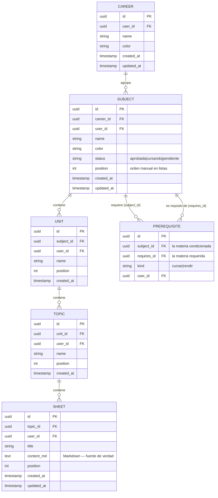

# Modelo de Datos — Studree

**Fuente de verdad:** **Supabase (PostgreSQL)** — ver ADR-007.
**Cache:** `localStorage` (optimista, descartable).
**Última actualización:** 2026-08-24

> **Cambio de modelo (2026-08-24).** Este documento describe el modelo **nuevo**, de
> jerarquía fija de 5 niveles con entidades explícitas (ADR-010). Reemplaza al modelo
> anterior (`Folder → Subject → TreeNode → Resource`), que queda al final como registro
> histórico. Por decisión del usuario **no hay migración de datos**: el esquema arranca
> vacío.

---

## Jerarquía

```
Career (Carrera)
└── Subject (Materia)        ←→ Prerequisite (correlativas entre materias)
    └── Unit (Unidad)
        └── Topic (Tema)
            └── Sheet (Hoja — documento Markdown)
```

Cada nivel es una **tabla propia**. La profundidad está garantizada por el esquema: no es
posible colgar una Hoja de una Unidad, ni anidar Temas dentro de Temas.

## Diagrama de Entidades



> **No existe columna de posición `x`/`y`.** El layout del canvas se calcula siempre con
> dagre a partir de la estructura (ADR-008). `position` es un **entero de orden** dentro
> de una lista (para el explorador y el export), no una coordenada del lienzo.

---

## Correlativas: dos tipos distintos

> **Son opcionales.** `prerequisites` es una tabla aparte, sin ninguna restricción que
> obligue a una materia a tener correlativas. Una materia sin filas en `prerequisites`
> es un caso normal, no un estado incompleto — así es como funciona un curso o una
> capacitación sin requisitos entre materias. Ver
> `docs/features/career-map.md` § "Las correlativas son opcionales".

En la facultad son requisitos diferentes y por eso se distinguen explícitamente en la
columna `kind` de `prerequisites`:

| `kind` | Significado | Bloquea |
|--------|-------------|---------|
| `cursar` | Materias que deben estar aprobadas (o con cursada regular) para **poder cursar** esta | Inscribirse a la cursada |
| `rendir` | Materias que deben estar aprobadas para **poder rendir el final** de esta | Rendir el final |

Una misma materia puede aparecer en ambas listas de otra (ej. *Álgebra* requerida para
cursar **y** para rendir *Análisis II*): son dos filas con distinto `kind`.

### Estado de una materia

`Subject.status` guarda solo lo que el usuario declara: `aprobada` o `cursando`
(default: `pendiente`). El estado **`bloqueada` es derivado, no se guarda**:

```
bloqueada  ⟺  ∃ correlativa de kind='cursar' cuya materia requerida NO está 'aprobada'
```

Se calcula en `src/lib/graph/subjectStatus.js`. Guardarlo sería redundante y quedaría
desincronizado apenas el usuario aprueba una materia.

### Regla de integridad: el grafo debe ser un DAG

Las correlativas forman un grafo dirigido que **no puede tener ciclos** (si A requiere B y
B requiere A, ninguna de las dos sería cursable nunca, y dagre entraría en bucle).

- Se valida **al guardar** una correlativa, no al renderizar (**ADR-009**).
- Si el alta cerraría un ciclo → se **rechaza** y se muestra el ciclo concreto.
- Implementación: `src/lib/graph/validateDag.js` (DFS de 3 colores).
- Además la base rechaza el caso trivial con un `CHECK (subject_id <> requires_id)`.

---

## Esquema SQL (Supabase)

> **La implementación de referencia es `supabase/migrations/0001_init.sql`** — ese archivo
> es la fuente de verdad del DDL. Lo de abajo es el resumen conceptual; si difieren, manda
> el `.sql`.

Además de las tablas, la migración real incluye tres cosas que el resumen no muestra:

1. **`user_id ... default auth.uid()`** — el cliente **nunca manda `user_id`**: lo pone
   Postgres a partir de la sesión. Elimina toda una clase de bugs y de agujeros de
   seguridad.
2. **Trigger `set_updated_at()`** en `careers`, `subjects` y `sheets` — mantiene
   `updated_at` sin depender de que el cliente se acuerde.
3. **RLS activado + política `_owner` por tabla** (`for all to authenticated`, con `using`
   y `with check` sobre `auth.uid() = user_id`). Sin sesión, `auth.uid()` es `NULL` y no
   se devuelve ni se inserta ninguna fila.

### Cómo aplicarla

Supabase Dashboard → **SQL Editor** → pegar `supabase/migrations/0001_init.sql` → **Run**.
(O `supabase db push` con la CLI.)

### Resumen de las tablas

```sql
create table careers (
  id         uuid primary key default gen_random_uuid(),
  user_id    uuid not null references auth.users(id) on delete cascade,
  name       text not null check (length(trim(name)) between 1 and 120),
  color      text not null default '#22c55e',
  created_at timestamptz not null default now(),
  updated_at timestamptz not null default now()
);

create table subjects (
  id         uuid primary key default gen_random_uuid(),
  career_id  uuid not null references careers(id) on delete cascade,
  user_id    uuid not null references auth.users(id) on delete cascade,
  name       text not null check (length(trim(name)) between 1 and 120),
  color      text not null default '#22c55e',
  status     text not null default 'pendiente'
             check (status in ('pendiente', 'cursando', 'aprobada')),
  position   int  not null default 0,
  created_at timestamptz not null default now(),
  updated_at timestamptz not null default now()
);

-- Correlativas: grafo dirigido entre materias. Debe ser un DAG (validado en el service).
create table prerequisites (
  id          uuid primary key default gen_random_uuid(),
  user_id     uuid not null references auth.users(id) on delete cascade,
  subject_id  uuid not null references subjects(id) on delete cascade, -- la condicionada
  requires_id uuid not null references subjects(id) on delete cascade, -- la requerida
  kind        text not null check (kind in ('cursar', 'rendir')),
  constraint no_self_prerequisite check (subject_id <> requires_id),
  unique (subject_id, requires_id, kind)
);

create table units (
  id         uuid primary key default gen_random_uuid(),
  subject_id uuid not null references subjects(id) on delete cascade,
  user_id    uuid not null references auth.users(id) on delete cascade,
  name       text not null check (length(trim(name)) between 1 and 200),
  position   int  not null default 0,
  created_at timestamptz not null default now()
);

create table topics (
  id         uuid primary key default gen_random_uuid(),
  unit_id    uuid not null references units(id) on delete cascade,
  user_id    uuid not null references auth.users(id) on delete cascade,
  name       text not null check (length(trim(name)) between 1 and 200),
  position   int  not null default 0,
  created_at timestamptz not null default now()
);

create table sheets (
  id         uuid primary key default gen_random_uuid(),
  topic_id   uuid not null references topics(id) on delete cascade,
  user_id    uuid not null references auth.users(id) on delete cascade,
  title      text not null check (length(trim(title)) between 1 and 200),
  content_md text not null default '',   -- Markdown: fuente de verdad (ADR-011)
  position   int  not null default 0,
  created_at timestamptz not null default now(),
  updated_at timestamptz not null default now()
);

-- Índices para las consultas del explorador y del canvas
create index on subjects (career_id);
create index on prerequisites (subject_id);
create index on prerequisites (requires_id);
create index on units (subject_id);
create index on topics (unit_id);
create index on sheets (topic_id);
```

### Reglas de integridad (cascada)

A diferencia del modelo anterior, **la cascada la hace Postgres** (`ON DELETE CASCADE`),
no los services:

- Borrar una **Career** → borra sus Subjects → Units → Topics → Sheets.
- Borrar un **Subject** → borra sus Units (y todo lo que cuelga) **y** las filas de
  `prerequisites` donde aparezca, sea como `subject_id` o como `requires_id`.
- Borrar el usuario → borra todo lo suyo.

---

## Cache en `localStorage`

> La cache **no es el modelo**: es una copia descartable para pintar rápido (ADR-007).
> Borrarla no debe perder datos. Ante conflicto, gana Supabase.

| Clave | Contenido |
|-------|-----------|
| `studree:cache:<tabla>` | Colección global (ej. `studree:cache:careers`) |
| `studree:cache:<tabla>:<parentId>` | Colección acotada a un padre (ej. `studree:cache:units:<subjectId>`) |
| `studree:cache:sheet:<id>` | Borrador local de una hoja (autosave del editor) |
| `studree:ui:tabs` | Tabs abiertas (preferencia de UI, no dato de negocio) |
| `studree:ui:explorer` | Nodos expandidos del explorador |

Las claves de cache se arman con `cacheKey(coleccion, parentId)` de
`cache.service.js`. **Todas empiezan con el prefijo `studree:cache:`**, porque
`clearAllCache()` borra por ese prefijo al cerrar sesión — si una clave de cache no lo
lleva, los datos de un usuario quedarían visibles para el siguiente que entre en el mismo
navegador.

> Las claves se centralizan en `src/constants/storageKeys.js`. Las claves del modelo
> anterior (`studree:folders`, `studree:subjects`, `studree:nodes`, `studree:resources`)
> quedan **obsoletas** y se eliminan.

---

## Preparado para IA (sin implementar todavía)

`sheets.content_md` guarda Markdown plano, lo que deja el contenido **chunkeable por
hoja** para un futuro RAG. **En esta etapa NO se implementa vectorización** (ni `pgvector`,
ni embeddings, ni búsqueda semántica): solo se deja el dato en el formato correcto.

---

## Historial de cambios del modelo

| Fecha | Cambio | Estado |
|-------|--------|--------|
| 2026-06-28 | Modelo inicial (Subject, TreeNode, Resource, Settings) | Obsoleto |
| 2026-06-28 | Añadido `Folder`; `Subject.folderId`; `TreeNode.completed` y `position` | Obsoleto |
| 2026-06-28 | `Resource` implementado + cascada por nodo | Obsoleto |
| 2026-08-24 | **Modelo nuevo**: 5 niveles explícitos (Career/Subject/Unit/Topic/Sheet) + `prerequisites` con `kind`; fuente de verdad en Supabase; se elimina la posición `x`/`y` | 📋 Documentado (implementación: Fase 1) |

### Modelo anterior (histórico)

`Folder (carrera) → Subject → TreeNode (recursivo con parentId) → Resource`, persistido en
`localStorage`. Reemplazado por los ADR-007 y ADR-010. Los typedefs viejos se conservan en
el historial de git (`src/types/models.js` antes del 2026-08-24).
