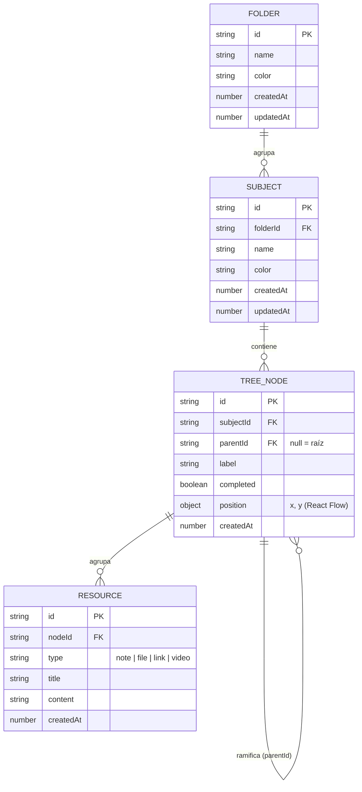

# Modelo de Datos — Studree

**Persistencia:** `localStorage` del navegador (sin base de datos remota aún).
**Última actualización:** 2026-06-28

> **Nota:** Studree todavía no usa una base de datos relacional. Este documento describe
> el **modelo de datos lógico** que se persiste en `localStorage`, siguiendo el espíritu
> del Mandamiento V. Cuando se incorpore un backend (Fase 6), se migrará al esquema real
> (tablas, FK, RLS, etc.).

---

## Jerarquía

```
Folder (Carrera / Curso)
└── Subject (Materia)
    └── TreeNode (Tema / concepto)   ← árbol con parentId (el "mapa")
        └── Resource (apunte/archivo/enlace/video)
```

## Diagrama de Entidades



---

## Claves de `localStorage`

| Clave | Contenido | Tipo | Estado |
|-------|-----------|------|--------|
| `studree:folders` | Carpetas (carreras/cursos) | `Folder[]` | ✅ Fase 2 |
| `studree:subjects` | Materias | `Subject[]` | ✅ Fase 2 |
| `studree:nodes` | Nodos del árbol (temas) | `TreeNode[]` | ✅ Fase 2 |
| `studree:resources` | Recursos asociados a nodos | `Resource[]` | ✅ Fase 4 |
| `studree:settings` | Preferencias del usuario | `Settings` | ⬜ Pendiente |

> Las claves se centralizan en `src/constants/storageKeys.js` (`STORAGE_KEYS`).

---

## Entidades (typedefs JSDoc — fuente: `src/types/models.js`)

### Folder (carrera / curso — la "carpeta")

```js
/**
 * @typedef {Object} Folder
 * @property {string} id        - Identificador único.
 * @property {string} name      - Nombre de la carrera/curso.
 * @property {string} color     - Color (hex de la paleta, ver constants/palette.js).
 * @property {number} createdAt - Timestamp de creación.
 * @property {number} updatedAt - Timestamp de última modificación.
 */
```

### Subject (materia — el "tronco")

```js
/**
 * @typedef {Object} Subject
 * @property {string} id        - Identificador único.
 * @property {string} folderId  - Carpeta (carrera/curso) a la que pertenece.
 * @property {string} name      - Nombre de la materia.
 * @property {string} color     - Color (hex de la paleta).
 * @property {number} createdAt - Timestamp de creación.
 * @property {number} updatedAt - Timestamp de última modificación.
 */
```

### TreeNode (tema/concepto — nodo del mapa)

```js
/**
 * @typedef {Object} TreeNode
 * @property {string} id                       - Identificador único.
 * @property {string} subjectId                - Materia a la que pertenece.
 * @property {string|null} parentId            - Nodo padre (null = raíz).
 * @property {string} label                    - Texto visible del nodo.
 * @property {boolean} completed               - Si el tema está completado.
 * @property {{x:number, y:number}|null} position - Posición manual (drag); null = auto-layout.
 * @property {number} createdAt                - Timestamp de creación.
 */
```

### Resource (pendiente) y Settings (pendiente)

```js
/**
 * @typedef {Object} Resource
 * @property {string} id
 * @property {string} nodeId
 * @property {'note'|'file'|'link'|'video'} type
 * @property {string} title
 * @property {string} content
 * @property {number} createdAt
 */

/**
 * @typedef {Object} Settings
 * @property {'dark'|'light'} theme
 */
```

---

## Reglas de integridad (cascada)

- Borrar un **Folder** → borra sus **Subjects** y, en cascada, los **TreeNodes** y **Resources** de esas materias.
- Borrar un **Subject** → borra sus **TreeNodes** (y los **Resources** de esos nodos).
- Borrar un **TreeNode** → borra sus **descendientes** (los nodos cuyo `parentId` cuelga de él) y los **Resources** de todos ellos.

> La cascada se implementa en los services (`folders.service.js`, `subjects.service.js`,
> `nodes.service.js`), no en la base de datos (no hay FK reales en localStorage).

---

## Historial de cambios del modelo

| Fecha | Cambio | Estado |
|-------|--------|--------|
| 2026-06-28 | Modelo inicial (Subject, TreeNode, Resource, Settings) | Propuesto |
| 2026-06-28 | Añadido `Folder` (carrera/curso); `Subject.folderId`; `TreeNode.completed` y `position` | ✅ Implementado (Fase 2) |
| 2026-06-28 | `Resource` implementado (notas/enlaces/videos/archivos como URL) + cascada por nodo | ✅ Implementado (Fase 4) |
