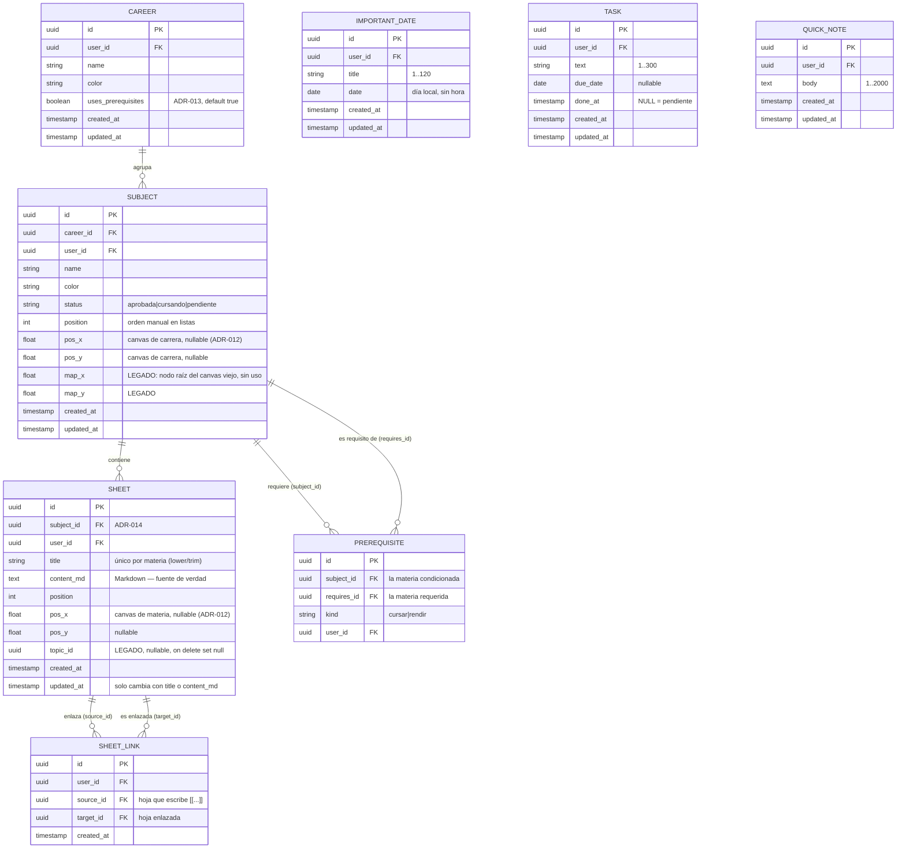

# Modelo de Datos — Studree

**Fuente de verdad:** **Supabase (PostgreSQL)** — ver ADR-007.
**Cache:** `localStorage` (optimista, descartable).
**Última actualización:** 2026-10-14 (migración 0005: tablas del Inicio — fechas, tareas y notas; **sin aplicar**)

> **Cambio de modelo (2026-10-14, ADR-014).** La jerarquía pasa de 5 niveles a **3**:
> Carrera → Materia → Hoja. Las hojas cuelgan directo de la materia y se conectan entre
> sí con `[[links]]` (ADR-015). `units` y `topics` quedan **deprecadas**: siguen en la
> base (sin UI ni services) y se eliminan en una migración posterior. La 0003 migró los
> datos existentes (cada hoja heredó la materia de su tema → unidad).

---

## Jerarquía

```
Career (Carrera / curso)
└── Subject (Materia)        ←→ Prerequisite (correlativas entre materias)
    └── Sheet (Hoja — documento Markdown)   ←→ SheetLink ([[links]] entre hojas)
```

Cada nivel es una **tabla propia** con FK real al padre. `sheet_links` no es jerarquía:
es un grafo entre hojas de la misma materia, **derivado del Markdown** (ver abajo).

Fuera de la jerarquía, el **Inicio** (migración 0005) tiene tres tablas sueltas del
usuario: `important_dates`, `tasks` y `quick_notes`. No cuelgan de ninguna carrera ni
materia (ver § "Inicio").

## Diagrama de Entidades



> **Posiciones del canvas (ADR-012).** `pos_x`/`pos_y` (en `subjects` para el canvas de
> carrera y en `sheets` para el canvas de materia) son coordenadas **opcionales** del
> lienzo de React Flow. `NULL` = el nodo lo ubica el auto-layout; con valor = el usuario lo
> acomodó a mano. "Reordenar" las vuelve a `NULL`. `position` es otra cosa: un **entero
> de orden** dentro de una lista (explorador y export), no una coordenada. Las posiciones
> se guardan en lote con la RPC `save_node_positions` (ADR-016).
>
> **Correlativas opcionales (ADR-013).** `careers.uses_prerequisites = false` oculta toda
> la UI de correlativas de esa carrera (curso / organizador). Las filas de
> `prerequisites` no se borran: solo se ignoran mientras esté en `false`.

---

## Correlativas: dos tipos distintos

> **Son opcionales.** `prerequisites` es una tabla aparte, sin ninguna restricción que
> obligue a una materia a tener correlativas. Una materia sin filas en `prerequisites`
> es un caso normal — así funciona un curso o una capacitación sin requisitos entre
> materias. Ver `docs/features/career-map.md` § "Las correlativas son opcionales".

| `kind` | Significado | Bloquea |
|--------|-------------|---------|
| `cursar` | Materias que deben estar aprobadas (o con cursada regular) para **poder cursar** esta | Inscribirse a la cursada |
| `rendir` | Materias que deben estar aprobadas para **poder rendir el final** de esta | Rendir el final |

Una misma materia puede aparecer en ambas listas de otra (ej. *Álgebra* requerida para
cursar **y** para rendir *Análisis II*): son dos filas con distinto `kind`.

### Estado de una materia

`Subject.status` guarda solo lo que el usuario declara: `aprobada` o `cursando`
(default: `pendiente`). El estado **`bloqueada` es derivado, no se guarda**:

```
bloqueada  ⟺  ∃ correlativa de kind='cursar' cuya materia requerida NO está 'aprobada'
```

Se calcula en `src/lib/graph/subjectStatus.js`.

### Regla de integridad: las correlativas deben ser un DAG

- Se valida **al guardar** una correlativa, no al renderizar (**ADR-009**).
- Si el alta cerraría un ciclo → se **rechaza** y se muestra el ciclo concreto.
- Implementación: `src/lib/graph/validateDag.js` (DFS de 3 colores).
- Además la base rechaza el caso trivial con un `CHECK (subject_id <> requires_id)`.

> Los **links entre hojas** NO son un DAG ni se validan como tal: que dos apuntes se
> enlacen mutuamente es normal (ver abajo).

---

## Links entre hojas (ADR-015)

Una hoja enlaza a otra escribiendo **`[[Título de la otra hoja]]`** en su Markdown. La
tabla `sheet_links` es un **índice derivado** de ese texto: el cliente nunca la escribe.

| Trigger (migración 0003) | Cuándo | Qué hace |
|---|---|---|
| `sheets_refresh_links` | `insert` o `update of content_md` | `refresh_sheet_links(id)`: parsea los `[[ ]]` (también la forma escapada `\[\[ \]\]`), los resuelve por título **dentro de la misma materia** sin distinguir mayúsculas y reemplaza las filas salientes de esa hoja |
| `sheets_title_links` | `insert` o `update of title` | Si es un rename, **reescribe** `[[título viejo]]` → `[[título nuevo]]` en las hojas que la enlazaban; y refresca las hojas que ya mencionaban el título nuevo (resuelve links "colgados") |

Reglas:

- Un `[[link]]` a un título que no existe no genera fila (queda "colgado" hasta que se
  crea esa hoja). El editor los muestra como "Todavía no existen".
- Una hoja no puede enlazarse a sí misma (`check (source_id <> target_id)`).
- El título **no puede contener corchetes** para ser enlazable.
- Los títulos son **únicos por materia** (índice `sheets_subject_title_unique` sobre
  `lower(trim(title))`), así un `[[link]]` nunca es ambiguo.
- Conectar/desconectar desde el canvas **edita el Markdown** del origen
  (`sheetLinks.service.js`); la base deriva el resto.
- Las funciones son `security invoker`: corren con los permisos (y el RLS) de quien edita.

## Posiciones en lote (ADR-016)

`save_node_positions(p_table, p_x_column, p_y_column, p_moves jsonb)`: un único `UPDATE`
para todos los nodos movidos (`p_moves = [{id, x, y}]`). **`security invoker`** (RLS
aplica: nadie mueve filas ajenas) y **whitelist** estricta de tabla/columnas
(`subjects.pos_*`, `subjects.map_*`, `sheets.pos_*`), porque el nombre de tabla se interpola
en SQL dinámico. Solo `authenticated` puede ejecutarla.

## `updated_at` de las hojas

El trigger `sheets_set_updated_at` solo se dispara si cambia `title` o `content_md`. Mover
un nodo **no** es editar la hoja: si no, el borrador local del editor (que se valida contra
`updated_at`, ver `docs/features/sheet-editor.md`) se descartaría sin motivo.

Por la misma razón, "Seguí donde dejaste" del Inicio usa la hoja con mayor `updated_at`
como **la última editada**.

## Inicio (migración 0005)

Tablas del Inicio (`docs/features/home.md`). Son colecciones globales del usuario, sin FK
a carrera ni materia: el usuario eligió que una fecha sea solo **título + día** (decisión
I4).

| Tabla | Columnas propias | Notas |
|-------|------------------|-------|
| `important_dates` | `title` (1..120), `date` | `date` es tipo `date`: el cliente lo maneja como `YYYY-MM-DD` en la hora local, así no se corre de día por la zona horaria |
| `tasks` | `text` (1..300), `due_date` (nullable), `done_at` (nullable) | `done_at` NULL = pendiente; con valor = hecha (y sirve para ordenar "Hechas") |
| `quick_notes` | `body` (1..2000) | Texto plano |

- Las tres tienen `user_id default auth.uid()`, el trigger `set_updated_at()`, RLS y la
  política `<tabla>_owner`.
- No hay funciones nuevas.
- Sus services usan `notifies: false` (no recargan el explorador).

---

## Esquema SQL (Supabase)

> **La implementación de referencia son los archivos de `supabase/migrations/`, en orden**
> (`0001_init.sql`, `0002_manual_layout_and_prereq_toggle.sql`,
> `0003_three_levels_and_sheet_links.sql`, …, `0005_home.sql`) — son la fuente de verdad del DDL. Lo de abajo
> es el resumen conceptual; si difieren, manda el `.sql`.

Además de las tablas, las migraciones incluyen:

1. **`user_id ... default auth.uid()`** — el cliente **nunca manda `user_id`**: lo pone
   Postgres a partir de la sesión.
2. **Trigger `set_updated_at()`** en `careers`, `subjects` y `sheets` (en `sheets`, solo
   por título o contenido).
3. **RLS activado + política `_owner` por tabla** (`for all to authenticated`, con `using`
   y `with check` sobre `auth.uid() = user_id`) — incluida `sheet_links`.
4. **Triggers de links** y **RPC de posiciones** (secciones de arriba).

### Cómo aplicarla

Supabase Dashboard → **SQL Editor** → pegar `0001_init.sql` → **Run**, después
`0002_manual_layout_and_prereq_toggle.sql` → **Run**, y después
`0003_three_levels_and_sheet_links.sql` → **Run** (0002 y 0003 son idempotentes), y así
en orden hasta `0005_home.sql` (idempotente).
(O `supabase db push` con la CLI.)

> **Estado de la 0005:** ⏳ **escrita, sin aplicar**. Se aplica solo con confirmación
> explícita del usuario, primero dentro de `begin … rollback` con asserts de RLS.

> **Estado (2026-10-14):** `0002` y `0003` aplicadas en el proyecto vía Management API.
> La 0003 se probó primero dentro de una transacción con `rollback` (asserts de links,
> rename, títulos con caracteres especiales, duplicados, whitelist y posiciones) y después
> con un E2E como usuario autenticado (RLS de `sheet_links` y de la RPC). 0 hojas sin
> `subject_id`. Para aplicar migraciones así, ver `docs/03-security.md` § "Token de
> acceso personal".

### Resumen de las tablas

```sql
create table careers (
  id                 uuid primary key default gen_random_uuid(),
  user_id            uuid not null references auth.users(id) on delete cascade,
  name               text not null check (length(trim(name)) between 1 and 120),
  color              text not null default '#22c55e',
  uses_prerequisites boolean not null default true,   -- 0002, ADR-013
  created_at         timestamptz not null default now(),
  updated_at         timestamptz not null default now()
);

create table subjects (
  id         uuid primary key default gen_random_uuid(),
  career_id  uuid not null references careers(id) on delete cascade,
  user_id    uuid not null references auth.users(id) on delete cascade,
  name       text not null check (length(trim(name)) between 1 and 120),
  color      text not null default '#22c55e',
  status     text not null default 'pendiente'
             check (status in ('pendiente', 'cursando', 'aprobada')),
  position   int  not null default 0,
  pos_x      double precision,   -- 0002, ADR-012
  pos_y      double precision,
  map_x      double precision,   -- 0002, LEGADO desde la 0003
  map_y      double precision,
  created_at timestamptz not null default now(),
  updated_at timestamptz not null default now()
);

-- Correlativas: grafo dirigido entre materias. Debe ser un DAG (validado en el service).
create table prerequisites (
  id          uuid primary key default gen_random_uuid(),
  user_id     uuid not null references auth.users(id) on delete cascade,
  subject_id  uuid not null references subjects(id) on delete cascade, -- la condicionada
  requires_id uuid not null references subjects(id) on delete cascade, -- la requerida
  kind        text not null check (kind in ('cursar', 'rendir')),
  constraint no_self_prerequisite check (subject_id <> requires_id),
  unique (subject_id, requires_id, kind)
);

-- units / topics: DEPRECADAS desde la 0003 (sin UI ni services). Se conservan hasta
-- una migración futura; borrar una no borra hojas (topic_id es on delete set null).

create table sheets (
  id         uuid primary key default gen_random_uuid(),
  subject_id uuid not null references subjects(id) on delete cascade,   -- 0003
  user_id    uuid not null references auth.users(id) on delete cascade,
  title      text not null check (length(trim(title)) between 1 and 200),
  content_md text not null default '',   -- Markdown: fuente de verdad (ADR-011)
  position   int  not null default 0,
  pos_x      double precision,           -- 0003, ADR-012
  pos_y      double precision,
  topic_id   uuid references topics(id) on delete set null,             -- LEGADO
  created_at timestamptz not null default now(),
  updated_at timestamptz not null default now()
);
create unique index sheets_subject_title_unique on sheets (subject_id, lower(trim(title)));

create table sheet_links (                                              -- 0003, ADR-015
  id         uuid primary key default gen_random_uuid(),
  user_id    uuid not null default auth.uid() references auth.users(id) on delete cascade,
  source_id  uuid not null references sheets(id) on delete cascade,
  target_id  uuid not null references sheets(id) on delete cascade,
  created_at timestamptz not null default now(),
  constraint no_self_link check (source_id <> target_id),
  unique (source_id, target_id)
);

-- Índices para las consultas del explorador y de los canvas
create index on subjects (career_id);
create index on prerequisites (subject_id);
create index on prerequisites (requires_id);
create index on sheets (subject_id);
create index on sheet_links (source_id);
create index on sheet_links (target_id);

-- Inicio (0005): tablas sueltas del usuario, sin FK a la jerarquía.
create table important_dates (
  id         uuid primary key default gen_random_uuid(),
  user_id    uuid not null default auth.uid() references auth.users(id) on delete cascade,
  title      text not null check (length(trim(title)) between 1 and 120),
  date       date not null,
  created_at timestamptz not null default now(),
  updated_at timestamptz not null default now()
);

create table tasks (
  id         uuid primary key default gen_random_uuid(),
  user_id    uuid not null default auth.uid() references auth.users(id) on delete cascade,
  text       text not null check (length(trim(text)) between 1 and 300),
  due_date   date,
  done_at    timestamptz,
  created_at timestamptz not null default now(),
  updated_at timestamptz not null default now()
);

create table quick_notes (
  id         uuid primary key default gen_random_uuid(),
  user_id    uuid not null default auth.uid() references auth.users(id) on delete cascade,
  body       text not null check (length(trim(body)) between 1 and 2000),
  created_at timestamptz not null default now(),
  updated_at timestamptz not null default now()
);

create index on important_dates (user_id, date);
create index on tasks (user_id, done_at, due_date);
create index on quick_notes (user_id, created_at);
```

### Reglas de integridad (cascada)

**La cascada la hace Postgres** (`ON DELETE CASCADE`), no los services:

- Borrar una **Career** → borra sus Subjects → Sheets → SheetLinks.
- Borrar un **Subject** → borra sus Sheets (y sus links) **y** las filas de
  `prerequisites` donde aparezca, sea como `subject_id` o como `requires_id`.
- Borrar una **Sheet** → borra sus filas de `sheet_links` (entrantes y salientes). El texto
  `[[título]]` en otras hojas queda, como link colgado.
- Borrar el usuario → borra todo lo suyo.

---

## Cache en `localStorage`

> La cache **no es el modelo**: es una copia descartable para pintar rápido (ADR-007).
> Borrarla no debe perder datos. Ante conflicto, gana Supabase.

| Clave | Contenido |
|-------|-----------|
| `studree:cache:<tabla>` | Colección global (ej. `studree:cache:careers`) |
| `studree:cache:<tabla>:<parentId>` | Colección acotada a un padre (ej. `studree:cache:sheets:<subjectId>`) |
| `studree:cache:<tabla>[<columnas>]:<parentId>` | Lista con columnas parciales (ej. hojas sin `content_md`) |
| `studree:cache:sheet:<id>` | Borrador local de una hoja: `{ content, baseUpdatedAt }` (ver `sheet-editor.md`) |
| `studree:ui:tabs` | Tabs abiertas (preferencia de UI, no dato de negocio) |
| `studree:ui:explorer` | Nodos expandidos del explorador |
| `studree:cache:important_dates` · `studree:cache:tasks` · `studree:cache:quick_notes` | Colecciones del Inicio (0005) |
| `studree:cache:home:lastSheet` | "Seguí donde dejaste": `{id, subject_id, updated_at, subject_name, subject_color, preview}`. Guarda solo el preview, no el contenido de la hoja |

Las claves de cache se arman con `cacheKey(coleccion, parentId)` de `cache.service.js`.
**Todas las claves de Studree empiezan con `studree:`**, y `clearAllCache()` borra por ese
prefijo (cache **y** UI) al cerrar sesión o al entrar con otra cuenta — si no, las tabs
(con títulos de hojas) de un usuario quedarían visibles para el siguiente que entre en el
mismo navegador.

> Las claves se centralizan en `src/constants/storageKeys.js`.

### Límite de filas

PostgREST devuelve **como máximo 1000 filas por consulta**. `crudService.list` y
`listByParents` **paginan** con `.range()` hasta traer todo; una consulta global sin
paginar se cortaría en silencio.

---

## Preparado para IA (sin implementar todavía)

`sheets.content_md` guarda Markdown plano, lo que deja el contenido **chunkeable por
hoja** para un futuro RAG. **En esta etapa NO se implementa vectorización.**

---

## Historial de cambios del modelo

| Fecha | Cambio | Estado |
|-------|--------|--------|
| 2026-06-28 | Modelo inicial (Subject, TreeNode, Resource, Settings) | Obsoleto |
| 2026-06-28 | Añadido `Folder`; `Subject.folderId`; `TreeNode.completed` y `position` | Obsoleto |
| 2026-06-28 | `Resource` implementado + cascada por nodo | Obsoleto |
| 2026-08-24 | 5 niveles explícitos (Career/Subject/Unit/Topic/Sheet) + `prerequisites` con `kind`; fuente de verdad en Supabase | Reemplazado por la 0003 (`0001_init.sql`) |
| 2026-10-14 | `careers.uses_prerequisites`; `pos_x`/`pos_y` en subjects/units/topics; `map_x`/`map_y` en subjects (ADR-012, ADR-013) | ✅ Implementado (`0002_manual_layout_and_prereq_toggle.sql`) |
| 2026-10-14 | **3 niveles** (ADR-014): `sheets.subject_id` + backfill, `sheets.pos_x/pos_y`, títulos únicos por materia, `units`/`topics` deprecadas; `sheet_links` derivada por triggers (ADR-015); RPC `save_node_positions` (ADR-016); `updated_at` de hojas solo por título/contenido | ✅ Implementado (`0003_three_levels_and_sheet_links.sql`) |
| 2026-10-14 | **Inicio**: `important_dates`, `tasks`, `quick_notes` + RLS `_owner` + `set_updated_at` | ⏳ Escrita, sin aplicar (`0005_home.sql`) |

### Modelos anteriores (histórico)

- `Folder (carrera) → Subject → TreeNode (recursivo) → Resource`, en `localStorage`.
  Reemplazado por ADR-007 y ADR-010.
- `Career → Subject → Unit → Topic → Sheet` (ADR-010). Reemplazado por ADR-014: abrir
  Unidad → Tema antes de llegar a una hoja era tedioso.
