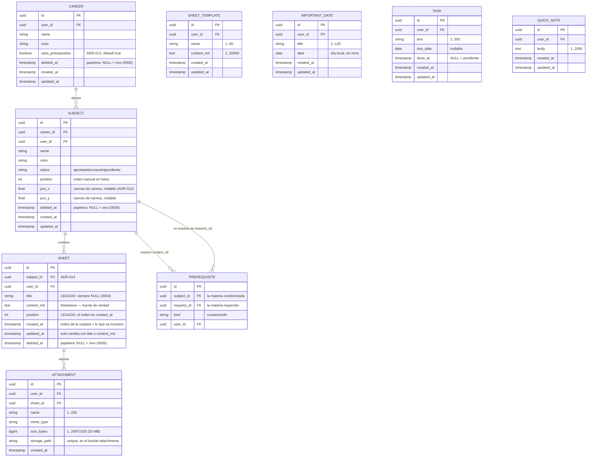

# Modelo de Datos — Studree

**Fuente de verdad:** **Supabase (PostgreSQL)** — ver ADR-007.
**Cache:** `localStorage` (optimista, descartable).
**Última actualización:** 2026-10-15 (migración 0006: papelera, adjuntos y plantillas)

> **La Carpeta (2026-10-14, ADR-017).** Jerarquía de 3 niveles (ADR-014): Carrera →
> Materia → Hoja. Las hojas **no tienen título** (se identifican por su fecha de creación y
> se muestran en orden cronológico); los temas son los headings `#` de su contenido. La
> 0004 convirtió cada título existente en el primer tema de su hoja y **eliminó**
> `sheet_links`, `units`, `topics` y las columnas sin uso.

---

## Jerarquía

```
Career (Carrera / curso)
└── Subject (Materia)        ←→ Prerequisite (correlativas entre materias)
    └── Sheet (Hoja — documento Markdown, fechado, sin título)
```

Cada nivel es una **tabla propia** con FK real al padre.

Fuera de la jerarquía, el **Inicio** (migración 0005) tiene tres tablas sueltas del
usuario: `important_dates`, `tasks` y `quick_notes`. No cuelgan de ninguna carrera ni
materia (ver § "Inicio").

## Diagrama de Entidades



> **Posiciones del canvas (ADR-012).** `subjects.pos_x/pos_y` son coordenadas
> **opcionales** del canvas de carrera. `NULL` = el nodo lo ubica dagre. "Reordenar" las
> vuelve a `NULL`. Se guardan en lote con `save_node_positions` (ADR-016).
>
> **Correlativas opcionales (ADR-013).** `careers.uses_prerequisites = false` oculta toda
> la UI de correlativas de esa carrera. Las filas de `prerequisites` no se borran.

---

## Hojas: la carpeta (ADR-017)

- **Sin título:** `title` es `NULL` (columna legada, nullable, sin check ni índice único).
  En la UI, la hoja se identifica por `created_at` ("Miércoles 14/10 · 18:30").
- **Orden:** cronológico por `created_at` (índice `sheets_subject_created_idx`). No hay
  reordenamiento.
- **Temas:** los headings `#`–`####` del `content_md`. No se guardan aparte: el índice de
  temas se calcula en el cliente.
- **`[[Tema]]`:** link a un tema de la misma materia, resuelto en el cliente. No hay tabla
  de links (la 0004 eliminó `sheet_links`, derivada desde la 0003).
- **Hoja vacía:** el cliente no la crea hasta que tiene contenido.
- **`updated_at`:** el trigger `sheets_set_updated_at` solo se dispara si cambia `title` o
  `content_md`. Lo usan el borrador local del editor y el "Seguí donde dejaste" del Inicio.

## Correlativas: dos tipos distintos

> **Son opcionales.** Una materia sin filas en `prerequisites` es un caso normal (cursos,
> capacitaciones). Ver `docs/features/career-map.md`.

| `kind` | Significado | Bloquea |
|--------|-------------|---------|
| `cursar` | Materias que deben estar aprobadas para **poder cursar** esta | Inscribirse a la cursada |
| `rendir` | Materias que deben estar aprobadas para **poder rendir el final** de esta | Rendir el final |

`Subject.status` guarda solo lo declarado (`pendiente` / `cursando` / `aprobada`). El
estado **`bloqueada` es derivado** (`src/lib/graph/subjectStatus.js`):

```
bloqueada  ⟺  ∃ correlativa de kind='cursar' cuya materia requerida NO está 'aprobada'
```

**Las correlativas deben ser un DAG:** se valida al guardar (ADR-009,
`src/lib/graph/validateDag.js`) y la base rechaza el caso trivial
(`CHECK (subject_id <> requires_id)`).

## Posiciones en lote (ADR-016)

`save_node_positions(p_table, p_x_column, p_y_column, p_moves jsonb)`: un único `UPDATE`
para todos los nodos movidos. **`security invoker`** (RLS aplica) y **whitelist**: desde la
0004 acepta **solo** `subjects (pos_x, pos_y)`. Solo `authenticated` puede ejecutarla.

Por la misma razón, "Seguí donde dejaste" del Inicio usa la hoja con mayor `updated_at`
como **la última editada**.

## Inicio (migración 0005)

Tablas del Inicio (`docs/features/home.md`). Son colecciones globales del usuario, sin FK
a carrera ni materia: el usuario eligió que una fecha sea solo **título + día** (decisión
I4).

| Tabla | Columnas propias | Notas |
|-------|------------------|-------|
| `important_dates` | `title` (1..120), `date` | `date` es tipo `date`: el cliente lo maneja como `YYYY-MM-DD` en la hora local, así no se corre de día por la zona horaria |
| `tasks` | `text` (1..300), `due_date` (nullable), `done_at` (nullable) | `done_at` NULL = pendiente; con valor = hecha (y sirve para ordenar "Hechas") |
| `quick_notes` | `body` (1..2000) | Texto plano |

- Las tres tienen `user_id default auth.uid()`, el trigger `set_updated_at()`, RLS y la
  política `<tabla>_owner`.
- No hay funciones nuevas.
- Sus services usan `notifies: false` (no recargan el explorador).

---

## Papelera (0006, ADR-019)

`careers`, `subjects` y `sheets` tienen `deleted_at timestamptz` (NULL = vivo).

- **Una sola marca por borrado.** `trash_item(p_table, p_id)` marca la fila y todos sus
  descendientes **vivos** con el mismo `deleted_at` (`clock_timestamp()`, no `now()`, para
  que dos borrados en una misma transacción no compartan marca). Devuelve la marca.
- **Restaurar.** `restore_item(p_table, p_id)` revive la fila y **solo** los descendientes
  con su misma marca (lo que se borró antes por separado sigue en la papelera). Si un
  ancestro está en la papelera, se restaura también ese ancestro (si no, lo restaurado no
  se vería); sus otros hijos no.
- **`list_trash()`** devuelve solo elementos de **primer nivel**: los que no tienen un
  padre marcado con la misma fecha, con conteos de lo que arrastran.
- **30 días.** `list_expired_trash(p_days default 30)` lista los vencidos; la purga la hace
  la app: primero borra los archivos de Storage (`attachment_paths_for`) y recién después
  las filas.
- Whitelist de `p_table`: solo `careers|subjects|sheets`. Todas las funciones son
  `security invoker` (RLS aplica).

## Adjuntos (0006)

Tabla `attachments` (solo cuelgan de hojas) y bucket **privado** `attachments` de Storage.

- Ruta: `<user_id>/<attachment_id>/<nombre>`; tope de 20 MB (tabla y bucket).
- En el Markdown se referencian como `adjunto:<id>`; no se guardan URLs.
- Sin `deleted_at` propio: siguen a su hoja (`on delete cascade`). Para borrar archivos
  se usa la API de Storage, no SQL.

## Plantillas (0006)

Tabla `sheet_templates`: plantillas propias del usuario (`name`, `content_md`). Las de
fábrica viven en `src/constants/sheetTemplates.js`, no en la base.

## Asistente de IA (0007)

Cuatro tablas, todas con RLS y `user_id` con `default auth.uid()` (el cliente nunca lo manda).

- **`user_plans`** (`user_id` PK, `plan` `'free'|'premium'` default `'free'`, `updated_at`).
  Política **solo `select` propio**: nadie se sube de plan desde la app. **El plan se
  cambia a mano en el panel de Supabase.** Sin fila = `free`.
- **`ai_usage`** (`id`, `user_id`, `action`, `external`, `created_at`). `action` en
  `chat`, `shortcut`, `summary`, `quiz`, `weak_review`, `study_plan`, `gaps`,
  `connections` y, desde la `0008`, `quiz_grade` (la corrección de pruebas tiene su balde
  `grade`). Políticas `select` e `insert` propios; **sin update ni delete**. Índice
  `(user_id, action, created_at desc)` para contar el uso diario. Qué acciones comparten
  balde y los topes por plan no viven en la base: están en
  `supabase/functions/assistant/config.js` (`BUCKET_OF`, `LIMITS`; p. ej. `study_plan`,
  `gaps` y `connections` cuentan juntas en `extras`).
- **`quiz_attempts`** (`id`, `user_id`, `scope_type` `sheet|subject|career|all`,
  `scope_id` nullable, `total` ≥ 0, `correct` ≥ 0, `created_at`). Política `_owner`.
- **`weak_topics`** (`id`, `user_id`, `subject_id` → `subjects` cascade, `sheet_id` nullable
  → `sheets` set null, `topic` 1..200, `misses` ≥ 1 default 1, `last_missed_at`,
  `updated_at`; único `(user_id, subject_id, topic)`). Política `_owner`. Índice
  `(user_id, subject_id)`. El cliente escribe con upsert sobre esa clave única
  (`quizResults.service.js`, `misses` calculado en el cliente) y solo con una materia viva
  resuelta (nunca adivinada); `quiz_attempts` se guarda con `correct ≤ total` validado en el
  cliente.

---

## Esquema SQL (Supabase)

> **La implementación de referencia son los archivos de `supabase/migrations/`, en orden**:
> `0001_init.sql`, `0002_manual_layout_and_prereq_toggle.sql`,
> `0003_three_levels_and_sheet_links.sql`, `0004_carpeta.sql`, `0005_home.sql`, `0006_fase13.sql`, `0007_asistente.sql`, `0008_quiz_grade_usage.sql`. Lo de abajo es el **estado
> resultante**; si difiere, manda el `.sql`.

Además de las tablas, las migraciones incluyen:
1. **`user_id ... default auth.uid()`**: el cliente **nunca manda `user_id`**.
2. **Trigger `set_updated_at()`** en `careers`, `subjects` y `sheets` (en `sheets`, solo
   por título o contenido).
3. **RLS activado + política `_owner` por tabla** (`for all to authenticated`, `using` y
   `with check` sobre `auth.uid() = user_id`).
4. **RPC `save_node_positions`** (sección de arriba).
5. **0006:** RPC de papelera (`trash_item`, `restore_item`, `list_trash`,
   `list_expired_trash`, `attachment_paths_for`), tablas `attachments` y `sheet_templates`
   con RLS `_owner`, y bucket privado `attachments` con 4 políticas en `storage.objects`.

### Cómo aplicarla

Supabase Dashboard → **SQL Editor** → correr en orden `0001` a `0008`. La
`0004` es **destructiva** (borra `sheet_links`, `units`, `topics` y columnas): autorizada
por el usuario el 2026-10-14.

> **Estado (2026-10-14):** `0002`, `0003` y `0004` aplicadas vía Management API. La 0004 se
> probó antes dentro de `begin … rollback` con asserts. Esa prueba encontró un bug de orden:
> los triggers de la 0003 dejaban `content_md` en NULL al anular títulos, así que se
> dropean primero. Resultado verificado: 3 hojas con su título convertido en `# tema`, sin
> `sheet_links`/`units`/`topics`, whitelist solo `subjects`. Para aplicar migraciones así,
> ver `docs/03-security.md` § "Token de acceso personal".

> **Estado de la 0005 (2026-10-15):** aplicada vía Management API. Solo agrega
> `important_dates`, `tasks` y `quick_notes` (idempotente); verificado RLS activo y una
> política `_owner` por tabla.

> **Estado de la 0006 (2026-10-15):** ✅ aplicada el 2026-10-15 vía Management API (antes,
> probada en una transacción `begin … rollback` con asserts). Es aditiva (no borra datos) e idempotente.

### Estado de las tablas

```sql
create table careers (
  id                 uuid primary key default gen_random_uuid(),
  user_id            uuid not null default auth.uid() references auth.users(id) on delete cascade,
  name               text not null check (length(trim(name)) between 1 and 120),
  color              text not null default '#22c55e',
  uses_prerequisites boolean not null default true,
  created_at         timestamptz not null default now(),
  updated_at         timestamptz not null default now()
);

create table subjects (
  id         uuid primary key default gen_random_uuid(),
  career_id  uuid not null references careers(id) on delete cascade,
  user_id    uuid not null default auth.uid() references auth.users(id) on delete cascade,
  name       text not null check (length(trim(name)) between 1 and 120),
  color      text not null default '#22c55e',
  status     text not null default 'pendiente' check (status in ('pendiente', 'cursando', 'aprobada')),
  position   int  not null default 0,
  pos_x      double precision,   -- canvas de carrera (ADR-012)
  pos_y      double precision,
  created_at timestamptz not null default now(),
  updated_at timestamptz not null default now()
);

create table prerequisites (
  id          uuid primary key default gen_random_uuid(),
  user_id     uuid not null default auth.uid() references auth.users(id) on delete cascade,
  subject_id  uuid not null references subjects(id) on delete cascade, -- la condicionada
  requires_id uuid not null references subjects(id) on delete cascade, -- la requerida
  kind        text not null check (kind in ('cursar', 'rendir')),
  constraint no_self_prerequisite check (subject_id <> requires_id),
  unique (subject_id, requires_id, kind)
);

create table sheets (
  id         uuid primary key default gen_random_uuid(),
  subject_id uuid not null references subjects(id) on delete cascade,
  user_id    uuid not null default auth.uid() references auth.users(id) on delete cascade,
  title      text,                       -- LEGADO: siempre NULL desde la 0004
  content_md text not null default '',   -- Markdown: fuente de verdad (ADR-011)
  position   int  not null default 0,    -- LEGADO
  created_at timestamptz not null default now(),
  updated_at timestamptz not null default now()
);

create index on subjects (career_id);
create index on prerequisites (subject_id);
create index on prerequisites (requires_id);
create index on sheets (subject_id);
create index sheets_subject_created_idx on sheets (subject_id, created_at);

-- Inicio (0005): tablas sueltas del usuario, sin FK a la jerarquía.
create table important_dates (
  id         uuid primary key default gen_random_uuid(),
  user_id    uuid not null default auth.uid() references auth.users(id) on delete cascade,
  title      text not null check (length(trim(title)) between 1 and 120),
  date       date not null,
  created_at timestamptz not null default now(),
  updated_at timestamptz not null default now()
);

create table tasks (
  id         uuid primary key default gen_random_uuid(),
  user_id    uuid not null default auth.uid() references auth.users(id) on delete cascade,
  text       text not null check (length(trim(text)) between 1 and 300),
  due_date   date,
  done_at    timestamptz,
  created_at timestamptz not null default now(),
  updated_at timestamptz not null default now()
);

create table quick_notes (
  id         uuid primary key default gen_random_uuid(),
  user_id    uuid not null default auth.uid() references auth.users(id) on delete cascade,
  body       text not null check (length(trim(body)) between 1 and 2000),
  created_at timestamptz not null default now(),
  updated_at timestamptz not null default now()
);

create index on important_dates (user_id, date);
create index on tasks (user_id, done_at, due_date);
create index on quick_notes (user_id, created_at);
```

### Reglas de integridad (cascada)

**La cascada la hace Postgres** (`ON DELETE CASCADE`):
- Borrar una **Career** → borra sus Subjects → Sheets.
- Borrar un **Subject** → borra sus Sheets **y** las `prerequisites` donde aparezca.
- Borrar el usuario → borra todo lo suyo.

---

## Cache en `localStorage`

> La cache **no es el modelo**: es una copia descartable para pintar rápido (ADR-007).

| Clave | Contenido |
|-------|-----------|
| `studree:cache:<tabla>` | Colección global (ej. `studree:cache:careers`) |
| `studree:cache:<tabla>:<parentId>` | Colección acotada a un padre |
| `studree:cache:<tabla>[<columnas>]:<parentId>` | Lista con columnas parciales (ej. las hojas de la carpeta) |
| `studree:cache:sheet:<id>` | Borrador local de una hoja: `{ content, baseUpdatedAt }` (ver `sheet-editor.md`) |
| `studree:cache:sheet-local:<subjectId>` | Borradores de hojas nuevas todavía no creadas: `{ [localId]: { content, created_at } }` |
| `studree:ui:tabs` | Tabs abiertas (una por materia) |
| `studree:ui:explorer` | Carreras expandidas en el explorador |
| `studree:ui:explorer-open` | Explorador abierto/cerrado (arranca cerrado, ADR-018) |
| `studree:ui:assistant-open` | Panel del Brote abierto/cerrado (Fase 14; en el celular no se reabre solo) |
| `studree:cache:important_dates` · `studree:cache:tasks` · `studree:cache:quick_notes` | Colecciones del Inicio (0005) |
| `studree:cache:home:lastSheet` | "Seguí donde dejaste": `{id, subject_id, updated_at, subject_name, subject_color, preview}`. Guarda solo el preview, no el contenido de la hoja |

**Todas las claves de Studree empiezan con `studree:`**, y `clearAllCache()` borra por ese
prefijo (cache **y** UI) al cerrar sesión o al entrar con otra cuenta.

### Límite de filas

PostgREST devuelve **como máximo 1000 filas por consulta**. `crudService.list` y
`listByParents` **paginan** con `.range()` hasta traer todo.

---

## Preparado para IA (sin implementar todavía)

`sheets.content_md` es Markdown plano, **chunkeable por hoja** y fechado. **No se
implementa vectorización en esta etapa.**

---

## Historial de cambios del modelo

| Fecha | Cambio | Estado |
|-------|--------|--------|
| 2026-06-28 | Modelo inicial en `localStorage` (Subject, TreeNode, Resource, Folder) | Obsoleto |
| 2026-08-24 | 5 niveles explícitos (Career/Subject/Unit/Topic/Sheet) + `prerequisites`; Supabase | Reemplazado (`0001_init.sql`) |
| 2026-10-14 | `careers.uses_prerequisites`; posiciones manuales (ADR-012, ADR-013) | ✅ `0002` |
| 2026-10-14 | 3 niveles (ADR-014): `sheets.subject_id`; `sheet_links` por triggers (ADR-015); RPC de posiciones (ADR-016) | ✅ `0003` (links derogados por la 0004) |
| 2026-10-14 | **La Carpeta** (ADR-017): hojas sin título (título → `# tema`), sin `sheet_links`/`units`/`topics`/posiciones de hojas/`map_*`; whitelist solo `subjects` | ✅ `0004` |
| 2026-10-14 | **Inicio**: `important_dates`, `tasks`, `quick_notes` + RLS `_owner` + `set_updated_at` | ✅ `0005` (aplicada el 2026-10-15) |
| 2026-10-15 | **Fase 13**: papelera (`deleted_at` + RPC), adjuntos (`attachments` + bucket privado), plantillas (`sheet_templates`) | ✅ `0006` (aplicada 2026-10-15 vía Management API, tras probarla con `begin … rollback`) |
| 2026-10-19 | **Fase 14 (asistente)**: `user_plans`, `ai_usage`, `quiz_attempts`, `weak_topics` + RLS | ✅ Aplicada el 2026-10-19 (`0007`) |
| 2026-10-19 | `ai_usage.action` admite `quiz_grade` (CHECK `ai_usage_action_check` reemplazado) | ✅ Aplicada el 2026-10-19 (`0008_quiz_grade_usage.sql`) |
